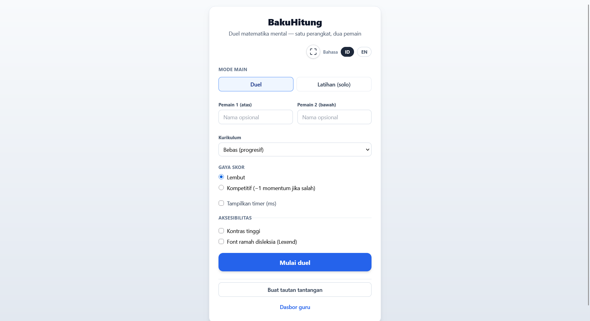
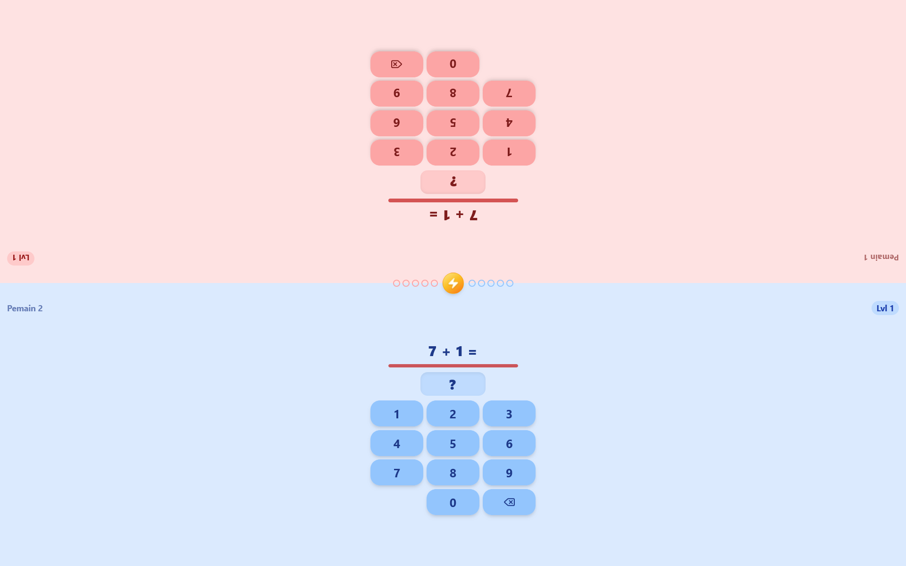
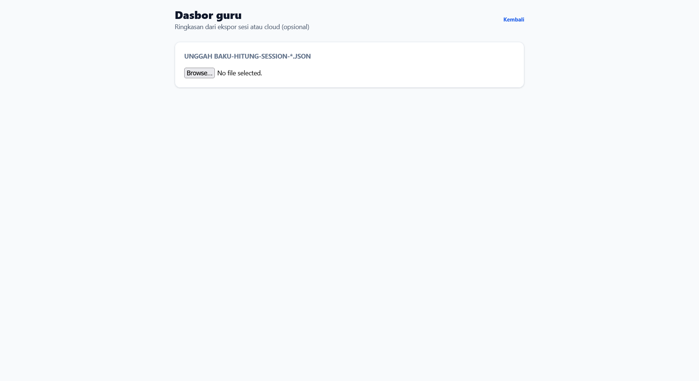

<div align="center">

# BakuHitung

**Adu tangkas matematika mental real-time · Real-time mental math duels**

[🇮🇩 Bahasa Indonesia](#bahasa-indonesia) · [🇬🇧 English](#english)

[](https://app.netlify.com/projects/bakuhitung/deploys)
[](./LICENSE)

### 🚀 [Live demo / Coba langsung → https://bakuhitung.netlify.app/](https://bakuhitung.netlify.app/)

</div>

---

## 📸 Screenshots / Tangkapan layar

| Lobby | Duel | Dashboard guru / Teacher dashboard |
|:-----:|:----:|:----------------------------------:|
|  |  |  |

---

<a id="bahasa-indonesia"></a>

# 🇮🇩 Bahasa Indonesia

[⬆️ Ke atas](#bakuhitung) · [🇬🇧 Switch to English](#english)

BakuHitung adalah eksperimen edutech berupa aplikasi web **adu tangkas matematika mental** real-time. Proyek ini lahir dari kebutuhan praktis membimbing siswa sekolah dasar mencintai matematika melalui kompetisi yang sehat dan interaktif.

Aplikasi memakai **split-screen** yang dioptimalkan untuk tablet dan smartphone: dua pemain bisa bertanding tatap muka dalam satu perangkat, atau berlatih solo dalam mode latihan.

## Fitur utama

| Area | Deskripsi |
|------|-----------|
| **Lobby** | Nama pemain, bahasa (ID/EN), mode duel/latihan, kurikulum, skor (lembut/kompetitif), timer opsional, aksesibilitas |
| **Duel** | Layar 50/50 horizontal; Pemain 1 diputar 180°; momentum ±5 (tug-of-war) |
| **Latihan** | Solo tanpa UI momentum; tetap ada progres level & soal adaptif |
| **Soal adaptif** | Generator algoritmik + bias ~70% ke tag skill yang lemah (dari riwayat sesi) |
| **Kurikulum** | Preset: Kelas 3 (perkalian 1–9), Kelas 4 (penjumlahan 2 digit), atau bebas |
| **Keypad kustom** | Tanpa keyboard OS; anti-spam & leading-zero guard |
| **Feedback** | Pesan motivasi growth mindset (quotes saat ini **Bahasa Indonesia** — lihat [F4.2](./POST-ROADMAP.md)) |
| **Ekspor sesi** | Unduh JSON event belajar dari duel/latihan (untuk guru) |
| **Dashboard guru** | `/teacher` — unggah JSON ekspor atau muat dari cloud (opsional) |
| **Tantangan async** | `/challenge/:seed` — 10 soal deterministik; bandingkan skor via perangkat yang sama atau impor/ekspor JSON |
| **PWA** | Instal dari browser; cache aset via Workbox |
| **Aksesibilitas** | Kontras tinggi, font dyslexia-friendly, hormati `prefers-reduced-motion` |

## Rute aplikasi

| Path | Fungsi |
|------|--------|
| `/` | Lobby → duel atau latihan |
| `/teacher` | Ringkasan statistik dari file JSON sesi (atau Supabase jika dikonfigurasi) |
| `/challenge/:seed` | Mode tantangan berbasis seed (link bisa dibagikan) |

## Mode tantangan (async)

1. Di lobby, pilih **Buat tantangan** — link `/challenge/<seed>` disalin ke clipboard.
2. Setiap pemain membuka link yang sama, mengerjakan **10 soal identik** (seed sama).
3. **Perangkat yang sama:** hasil disimpan di `localStorage` per seed; papan peringkat tampil otomatis setelah beberapa pemain main di browser yang sama.
4. **Perangkat berbeda:** setelah selesai, **Ekspor hasil** → kirim file JSON ke rival → rival **Impor lawan** di layar hasil untuk membandingkan waktu dan akurasi.

Tidak ada WebSocket; sinkronisasi sengaja offline-first.

## Tech stack

- **Vue 3** (Composition API) + **Vue Router**
- **Vite** + **Vitest**
- **Tailwind CSS**
- **vue-i18n** (Indonesia & English)
- **Lucide Vue Next**
- **vite-plugin-pwa**
- Deploy: **Netlify** ([`netlify.toml`](./netlify.toml)) — [demo langsung](https://bakuhitung.netlify.app)

## Instalasi & pengembangan

**Persyaratan:** Node.js 20+ (sama dengan CI).

```bash
git clone https://github.com/kahlilzulmi/baku-hitung.git
cd baku-hitung
npm install
npm run dev
```

| Perintah | Kegunaan |
|----------|----------|
| `npm run dev` | Server pengembangan (host terbuka untuk uji di tablet/HP di LAN) |
| `npm run build` | Build produksi |
| `npm run preview` | Preview build lokal |
| `npm test` | Unit test (domain engine) |

Ingin berkontribusi? Lihat **[CONTRIBUTING.md](./CONTRIBUTING.md)**. Backlog lanjutan: **[POST-ROADMAP.md](./POST-ROADMAP.md)**.

## Variabel lingkungan (opsional)

Tanpa file `.env`, aplikasi **sepenuhnya offline** (event belajar di `sessionStorage`).

Untuk sinkronisasi cloud ke Supabase, salin [`.env.example`](./.env.example) ke `.env` dan isi:

```env
VITE_SUPABASE_URL=https://your-project.supabase.co
VITE_SUPABASE_ANON_KEY=your-anon-key
```

Tabel yang diharapkan (ringkas):

- `sessions` — `id`, `started_at`, `play_mode`, `curriculum_id`, `scoring_mode`
- `events` — `session_id`, `player`, `level`, `question_text`, `expected_answer`, `skill_tags`, `response_ms`, `correct`, `attempt`, `created_at`

Setelah deploy, dashboard `/teacher` menampilkan opsi muat sesi berdasarkan `sessionId` (UUID dari ekspor JSON).

## Ekspor data belajar

Selama duel atau latihan, setiap jawaban dicatat sebagai `LearningEvent` (maks. 500 event di `sessionStorage`).

- Tombol **Ekspor sesi** mengunduh JSON berisi `sessionId`, metadata, dan array event.
- Guru membuka **`/teacher`** → unggah file tersebut untuk melihat agregat (akurasi per skill, waktu respons, dll.).

> **Catatan:** Beberapa filter per-`sessionId` masih dalam perbaikan — lihat [F1.x](./POST-ROADMAP.md) di backlog.

## PWA

Setelah `npm run build` dan deploy, pengguna dapat **Add to Home Screen** / instal aplikasi. Manifest: nama `BakuHitung`, locale default `id`, theme biru (`#2563eb`).

## Kolaborasi manusia–AI

Proyek ini juga dokumentasi kolaborasi manusia–AI dalam pengembangan modern:

- **Brainstorming & konsep** — Kahlil Gibran Al Zulmi × Google Gemini (mekanik tug-of-war, tingkat kesulitan inklusif, branding).
- **Arsitektur & scaffolding** — struktur kode & state dengan GitHub Copilot.
- **Optimasi & integrasi** — penyempurnaan lanjutan dengan bantuan alat AI (Antigravity dll.).

Kontributor manusia dan AI dipersilakan; lihat panduan transparansi di [CONTRIBUTING.md](./CONTRIBUTING.md).

## Lisensi

Proyek ini dilisensikan di bawah [MIT License](./LICENSE).

---

<a id="english"></a>

# 🇬🇧 English

[⬆️ Back to top](#bakuhitung) · [🇮🇩 Beralih ke Bahasa Indonesia](#bahasa-indonesia)

BakuHitung (a pun from "baku hantam" which means "brawl") is an edutech experiment: a real-time **mental math duel** web app. It grew out of a practical need, helping primary school students come to love math through healthy, interactive competition.

The app uses a **split-screen** layout optimized for tablets and smartphones: two players can face off on a single device, or one player can practice solo in practice mode.

## Key features

| Area | Description |
|------|-------------|
| **Lobby** | Player names, language (ID/EN), duel/practice mode, curriculum, scoring (gentle/competitive), optional timer, accessibility options |
| **Duel** | 50/50 horizontal split screen; Player 1 rotated 180°; ±5 momentum (tug-of-war) |
| **Practice** | Solo mode without the momentum UI; level progress and adaptive questions still apply |
| **Adaptive questions** | Algorithmic generator with ~70% bias toward weak skill tags (from session history) |
| **Curriculum** | Presets: Grade 3 (multiplication 1–9), Grade 4 (2-digit addition), or free-form |
| **Custom keypad** | No OS keyboard; anti-spam and leading-zero guard |
| **Feedback** | Growth-mindset motivational messages (quotes are currently **Indonesian only**, see [F4.2](./POST-ROADMAP.md)) |
| **Session export** | Download learning events from duels/practice as JSON (for teachers) |
| **Teacher dashboard** | `/teacher`: upload an exported JSON or load from the cloud (optional) |
| **Async challenge** | `/challenge/:seed`: 10 deterministic questions; compare scores on the same device or via JSON import/export |
| **PWA** | Installable from the browser; asset caching via Workbox |
| **Accessibility** | High contrast, dyslexia-friendly font, respects `prefers-reduced-motion` |

## App routes

| Path | Purpose |
|------|---------|
| `/` | Lobby → duel or practice |
| `/teacher` | Statistics summary from session JSON files (or Supabase if configured) |
| `/challenge/:seed` | Seed-based challenge mode (shareable link) |

## Challenge mode (async)

1. In the lobby, choose **Create challenge**. The `/challenge/<seed>` link is copied to your clipboard.
2. Each player opens the same link and solves the **same 10 questions** (same seed).
3. **Same device:** results are stored in `localStorage` per seed; a leaderboard appears automatically once several players have played in the same browser.
4. **Different devices:** when finished, tap **Export result** → send the JSON file to your rival → the rival taps **Import opponent** on the results screen to compare time and accuracy.

There is no WebSocket; syncing is deliberately offline-first.

## Tech stack

- **Vue 3** (Composition API) + **Vue Router**
- **Vite** + **Vitest**
- **Tailwind CSS**
- **vue-i18n** (Indonesian & English)
- **Lucide Vue Next**
- **vite-plugin-pwa**
- Deploy: **Netlify** ([`netlify.toml`](./netlify.toml)) — [live demo](https://bakuhitung.netlify.app)

## Installation & development

**Requirements:** Node.js 20+ (same as CI).

```bash
git clone https://github.com/kahlilzulmi/baku-hitung.git
cd baku-hitung
npm install
npm run dev
```

| Command | Purpose |
|---------|---------|
| `npm run dev` | Development server (host exposed for testing on tablets/phones over LAN) |
| `npm run build` | Production build |
| `npm run preview` | Preview the build locally |
| `npm test` | Unit tests (domain engine) |

Want to contribute? See **[CONTRIBUTING.md](./CONTRIBUTING.md)**. Ongoing backlog: **[POST-ROADMAP.md](./POST-ROADMAP.md)**.

## Environment variables (optional)

Without a `.env` file, the app runs **fully offline** (learning events live in `sessionStorage`).

For cloud sync to Supabase, copy [`.env.example`](./.env.example) to `.env` and fill in:

```env
VITE_SUPABASE_URL=https://your-project.supabase.co
VITE_SUPABASE_ANON_KEY=your-anon-key
```

Expected tables (summary):

- `sessions` — `id`, `started_at`, `play_mode`, `curriculum_id`, `scoring_mode`
- `events` — `session_id`, `player`, `level`, `question_text`, `expected_answer`, `skill_tags`, `response_ms`, `correct`, `attempt`, `created_at`

After deployment, the `/teacher` dashboard offers loading a session by `sessionId` (the UUID from the JSON export).

## Learning data export

During a duel or practice session, every answer is recorded as a `LearningEvent` (max. 500 events in `sessionStorage`).

- The **Export session** button downloads a JSON file containing `sessionId`, metadata, and the event array.
- Teachers open **`/teacher`** and upload that file to see aggregates (accuracy per skill, response time, etc.).

> **Note:** Some per-`sessionId` filters are still being fixed. See [F1.x](./POST-ROADMAP.md) in the backlog.

## PWA

After `npm run build` and deployment, users can **Add to Home Screen** / install the app. Manifest: name `BakuHitung`, default locale `id`, blue theme (`#2563eb`).

## Human–AI collaboration

This project also documents human–AI collaboration in modern development:

- **Brainstorming & concept**: Kahlil Gibran Al Zulmi × Google Gemini (tug-of-war mechanic, inclusive difficulty levels, branding).
- **Architecture & scaffolding**: code structure and state with GitHub Copilot.
- **Optimization & integration**: further refinement with AI tools (Antigravity, etc.).

Human and AI contributors are welcome; see the transparency guidelines in [CONTRIBUTING.md](./CONTRIBUTING.md).

## License

This project is licensed under the [MIT License](./LICENSE).

---

Copyright © 2026 Kahlil Gibran Al Zulmi
